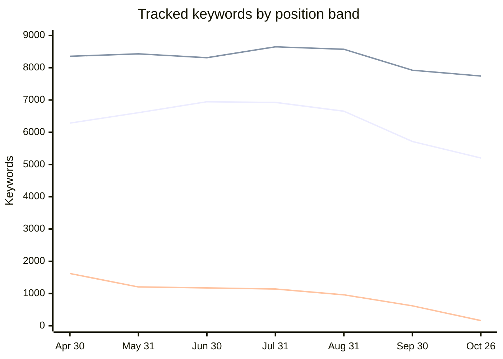
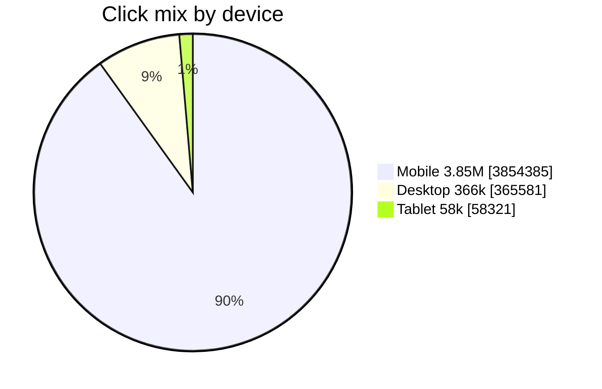
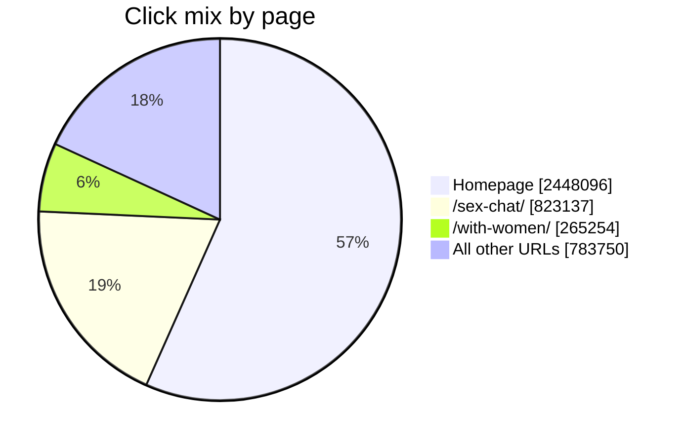

# isexychat.com search status

Organic search is the business: 6.90 million organic sessions from 1 Jan to 26 Oct 2026, 78% of all sessions, and about double the prior matched window. The latest quarter is where that growth stopped. Search Console clicks for the last 3 months are 4.28 million, down 2.5% from the previous 3 months. Rankings peaked at the end of June and have fallen every month since August.

Sources: Google Search Console, last 3 months vs the previous 3 months, export 26 Oct 2026. Ahrefs organic positions, 26 Apr–26 Oct 2026, plus a keyword and page compare from mid-September to 22–23 Oct 2026. GA4, 1 Jan–26 Oct 2026 vs 8 Mar–31 Dec 2025 (299 days each).

Charts below are Mermaid. GitHub renders them. The tables under each chart hold the same numbers if a viewer does not.

## The quarter hides a September break

Keywords in positions 1–3 rose from 6,284 on 30 Apr to a peak of 6,946 on 30 Jun, held at 6,925 on 31 Jul, then fell to 5,202 on 26 Oct. That is a 25% loss of top-3 keywords in three months. Positions 11 and deeper fell from about 1,100 tracked keywords in July to 162. Search Console looks milder because July, inside the comparison quarter, was still near the peak.

| Clicks, last 3 months | Avg. position, “sex chat” | Keywords in positions 1–3 | Organic sessions vs prior year |
| --- | --- | --- | --- |
| **4.28M** (−2.5%) | **5.3** (was 4.5) | **5,202** (was 6,925) | **+109%** |

## Tracked keywords by position band

Keyword count on the last day of each month. Y-axis: keywords. Source: Ahrefs organic positions history, 30 Apr–26 Oct 2026.

| Date | Positions 1–3 | Positions 4–10 | Positions 11+ |
| --- | ---: | ---: | ---: |
| 30 Apr | 6,284 | 8,356 | 1,621 |
| 31 May | 6,607 | 8,430 | 1,204 |
| 30 Jun | 6,946 | 8,312 | 1,175 |
| 31 Jul | 6,925 | 8,649 | 1,141 |
| 31 Aug | 6,653 | 8,573 | 961 |
| 30 Sep | 5,714 | 7,923 | 619 |
| 26 Oct | 5,202 | 7,743 | 162 |

## Clicks in the largest countries

Clicks, in thousands. Last 3 months against the previous 3 months. Source: Search Console countries export, 26 Oct 2026.

```mermaid
xychart-beta
    title "Clicks in the largest countries (thousands)"
    x-axis ["India", "US", "UK", "Canada", "Philippines", "Germany", "Australia"]
    y-axis "Clicks (thousands)" 0 --> 1800
    bar "Previous 3 months" [1564, 782, 227, 146, 131, 115, 91]
    bar "Last 3 months" [1472, 779, 218, 152, 117, 116, 92]
```

| Country | Previous 3 months | Last 3 months | Change |
| --- | ---: | ---: | ---: |
| India | 1,564k | 1,472k | −92k |
| United States | 782k | 779k | −3k |
| United Kingdom | 227k | 218k | −9k |
| Canada | 146k | 152k | +6k |
| Philippines | 131k | 117k | −14k |
| Germany | 115k | 116k | +1k |
| Australia | 91k | 92k | +1k |

## Where the clicks went

One query and one page account for most of the loss. “sex chat” lost 62,000 clicks as its average position moved from 4.5 to 5.3, on 4.43 million impressions. The homepage lost 239,000 clicks and slipped from position 5.8 to 6.5. `/chatrooms/sex-chat/` gained 135,000 clicks over the same window, so part of the homepage drop is Google moving the head term onto the room page. The net of those two URLs is still about 104,000 clicks down. `/chatrooms/sex-chat/with-men/` is a separate failure: impressions fell 41% and clicks fell 52%.

### Head queries in Search Console

Clicks and average position, last 3 months vs the previous 3 months. The export has 1,091 queries and covers 2.30 million of 4.28 million clicks. The rest sit below the row cap.

| Query | Clicks | Change | Impressions | CTR | Position | Prior position |
| --- | ---: | ---: | ---: | ---: | ---: | ---: |
| sex chat | 328k | −16% | 4.43M | 7.4% | 5.3 | 4.5 |
| isexychat | 486k | −5% | 543k | 89.5% | 1.0 | 1.0 |
| free sex chat | 47k | −21% | 900k | 5.2% | 5.4 | 4.3 |
| sexchat | 41k | +111% | 549k | 7.6% | 5.0 | 5.3 |
| live sex chat | 32k | −14% | 398k | 8.1% | 5.1 | 4.8 |
| sex video chat | 28k | −23% | 396k | 7.0% | 7.4 | 6.4 |
| adult chat | 12k | +5% | 1.06M | 1.1% | 6.6 | 6.8 |
| sexy chat | 15k | +1,287% | 102k | 15.1% | 4.7 | 8.7 |

### Pages that move the total

Search Console pages. Position is the impression-weighted average. Adult chat is the unused impression pool: 2.16 million impressions at position 8.6 with a 1.5% CTR.

| URL | Clicks | Change | Impressions | CTR | Position |
| --- | ---: | ---: | ---: | ---: | --- |
| `/` | 2.45M | −8.9% | 20.6M | 11.9% | 6.5 (was 5.8) |
| `/chatrooms/sex-chat/` | 823k | +19.6% | 6.79M | 12.1% | 5.3 |
| `/chatrooms/sex-chat/with-women/` | 265k | +1.4% | 1.73M | 15.3% | 6.4 |
| `/chatrooms/sex-chat/with-men/` | 50k | −52% | 967k (−41%) | 5.1% | 6.0 (was 5.3) |
| `/chatrooms/adult-chat/` | 33k | +6% | 2.16M | 1.5% | 8.6 |
| `chat.isexychat.com` | 45k | +249% | 506k | 9.0% | 2.2 (was 1.4) |

## Click mix by device

90% of 4.28 million clicks are mobile.

| Device | Clicks | Share of 4.28M |
| --- | ---: | ---: |
| Mobile | 3,854,385 | 90.1% |
| Desktop | 365,581 | 8.5% |
| Tablet | 58,321 | 1.4% |

Mobile position moved from 5.8 to 6.1. Desktop is 8.5% of clicks, and its impressions fell 14% while position moved from 8.7 to 9.5.

## Click mix by page

The homepage is still 57% of page-report clicks (4.32 million).

| Page | Clicks | Share of 4.32M page-report clicks |
| --- | ---: | ---: |
| `/` | 2,448,096 | 56.7% |
| `/chatrooms/sex-chat/` | 823,137 | 19.1% |
| `/chatrooms/sex-chat/with-women/` | 265,254 | 6.1% |
| All other URLs | 783,750 | 18.1% |

The blog is 229 URLs and 24,000 clicks, inside “all other URLs.”

## Patterns

| Pattern | Evidence | What it means |
| --- | --- | --- |
| Head-term slip | “sex chat” 4.5 → 5.3. “free sex chat” 4.3 → 5.4. Non-brand queries in the export: position 5.5 → 6.0, clicks −8.6%. | The commercial queries that pay the quarter moved about one place down the page. CTR fell with the rank. |
| URL ownership is unstable | Ahrefs, mid-Sep to late Oct: “free sex chat” in India moved from `/sex-chat/` (pos 6) to the homepage (pos 7). “sex chat free” in the US moved from the homepage to `/live-chat/`. “online sex chat” in the US moved from `/sex-chat/` to `/adult-chat/` and improved to position 1. | Google is reassigning the same intents across four URLs. Some swaps helped. The India swap made the rank worse. |
| Adult-chat snippet fails | Query “adult chat”: 1.06M impressions, position 6.6, CTR 1.1%. The page: 2.16M impressions, CTR 1.5%. `/sex-chat/` at a similar rank converts at 12%. | The page is visible and rarely chosen. Title, description, and which query it is allowed to own are the first levers. |
| Video intent fell faster | Cam and video queries in the export: 278k clicks, −12%, position 7.1 → 7.7. “sex video chat” −23%. “porn chat” −43% as position went 5.1 → 6.6. | Text-chat demand softened. Video-call demand softened more, and `/video-chat/` still averages position 33. |
| Brand is intact, demand is slightly lower | “isexychat” is position 1 with an 89.5% CTR. Clicks −5%. Fifty-one brand-like queries: position 1.0, clicks −4%. | Branded search volume eased. Rankings for the brand held. Protect the sitelinks so a deep room URL does not become the US brand result. |
| India is the swing market | 1.47M clicks, 34% of the total, −92,000 clicks (−5.9%). Position 4.5 → 5.1. The US was flat (−0.4%) at a 9.9% CTR. Philippines −10%, position 4.6 → 5.3. Indonesia −55% on a small base. | A one-position loss in India moves the global total. The US is stable and under-clicked relative to India, which fits a harder SERP. |
| AMP still carries a third of clicks | AMP article regular results: 1.46M clicks, 34% of all clicks, position 8.1, CTR 12.1%. Rich AMP articles are only 12k clicks at a 1.9% CTR. | The ordinary AMP URL, not the AMP carousel, is the dependency. Keep canonical titles and AMP templates in parity while ranks are repaired. |
| Sitelinks distort position-1 reports | `/general-chat/` and `/rules/` average position 1.1 on 672k and 570k impressions, with CTRs of 0.35% and 0.33%. Ahrefs assigns US “isexychat” traffic to `/mobile-chat/with-women/`, which has 179 Search Console clicks. | Read Ahrefs URL swaps on brand queries as sitelink noise unless Search Console clicks move with them. `/rules/` is occupying a sitelink slot users do not choose. |

## Two measurement gaps change how this plan is judged

GA4 recorded 4 key events on 6.90 million organic sessions, and revenue is zero in the export. Signup and chat-start are not measurable, so a ranking win cannot be tied to use of the product. Ahrefs estimated organic traffic on the keyword file fell 12% between mid-September and 23 Oct, and estimated traffic value on the page file fell from about $244k to $205k. Use those figures to spot URL swaps. Use Search Console for clicks.

## Three-month plan

November through January. The goal is to stop the August–October slide, put one URL on each head query, and get adult-chat chosen when it is already shown. The blog, new languages, and new room templates wait until those three are moving.

### November — freeze the map and the measurement

Assign one indexable URL to each of these queries and write the assignment down: sex chat, free sex chat, live sex chat, sex video chat, adult chat, porn chat, sex chat with girls, sex chat with men. Point internal anchors at that URL only. The working hypothesis from the swaps: `/sex-chat/` owns “sex chat” and “free sex chat”; `/adult-chat/` owns “adult chat”; `/with-women/` and `/with-men/` own the gendered queries; the homepage owns the brand.

Rewrite the title and description on `/adult-chat/` first. It already has 2.16 million impressions. A move from 1.5% CTR to 3% is about 32,000 extra clicks a quarter without a ranking change. Then check `/with-men/`: impressions fell from 1.65 million to 0.97 million while average position only moved from 5.3 to 6.0, so a slice of its queries left the index or moved to another URL.

Set GA4 key events for registration and for a chat actually starting, broken out by landing page and by country. Check why desktop impressions fell 14%. Keep AMP, and confirm the AMP title matches the canonical title on the homepage and `/sex-chat/`. Strengthen internal links to the four money rooms so `/rules/` and `/general-chat/` are less likely to take the sitelink slots. Keep `chat.isexychat.com` from competing with the apex on the brand query: one host should be the brand result, the other a sitelink.

### December — take “sex chat” back under position 4.5

Ship the on-page difference between the homepage and `/sex-chat/`. The room page needs a visible free-chat value proposition, a short FAQ, and internal links using the exact head queries. The homepage should read as the brand and the directory, so it stops pulling “free sex chat” in India onto a URL that ranks worse for it.

Give the video cluster a single owner. `/video-chat/` gained clicks but still averages position 33 on 93,000 impressions, while “sex video chat” and “porn chat” lost rank on whichever URL currently holds them. Either consolidate those queries onto `/video-chat/` and link to it from `/sex-chat/`, or keep them on `/sex-chat/` and stop the third URL from competing.

India and the Philippines are the rank checks that matter. Both lost about half a position and both have high CTRs, so a recovery there shows up in clicks quickly. `/sex-chat/` has 92 referring domains against 2,846 on the homepage. Pass internal links from the homepage, the blog, and the gendered rooms before spending on new links. Refresh the dirty-text-messages post, which moved from position 18.7 to 13.6, and add links from it into the room it supports.

### January — extend what recovered, and read signups

If `/adult-chat/` CTR has lifted, push that page from position 8.6 toward the top 5 with the same internal-link pattern used on `/sex-chat/`. If `/with-men/` impressions are still near 1 million, rebuild that template instead of adding more rooms. Lesbian chat already improved from position 12.5 to 8.0, and teen chat from 12.6 to 10.7: those are the next pages to move onto page 1, after the head terms.

Review the 557 Ahrefs keywords marked lost (about 89,000 of prior estimated traffic in the five-week compare). Restore the ones that were real rankings on the assigned URL. Ignore brand-query URL changes that Search Console does not support with clicks. Canada, Egypt, South Africa, and Iran gained clicks through the downturn; keep their landing pages in the same template as the pages that recover in India.

Arabic “سكس شات” has 124,000 impressions at position 10 and a 2.2% CTR. That is the localization test, and only after the English head terms have stopped falling: one Arabic landing page, not a sitewide translation. Report the quarter on Search Console clicks, the position of the eight assigned queries, India clicks, adult-chat CTR, and the new organic key-event rate.

## Targets for 26 Jan 2027

Compared with the 26 Oct 2026 export. These are operating targets for the work above, not a forecast.

| Metric | Now | Target | Why this bar |
| --- | --- | --- | --- |
| Keywords in positions 1–3 | 5,202 | Above 6,000, and no longer falling | July baseline was 6,925. Stopping the slide comes before a full recovery. |
| “sex chat” average position | 5.3 | 4.5 or better | This query alone was 62k of the quarterly click loss. |
| Quarterly Search clicks | 4.28M | Back to 4.39M | Restores the previous 3 months. |
| `/adult-chat/` CTR | 1.5% | 3% or better | About +32k clicks on current impressions. |
| `/with-men/` impressions | 0.97M | Above 1.3M | Prior quarter was 1.65M. Rank barely explains the drop. |
| Organic key events | 4 events | Firing on signup and chat start | Otherwise January cannot show whether better ranks become use. |

Order of work if time is short: query-to-URL map, adult-chat snippet, with-men diagnosis, India rank on “sex chat” and “free sex chat”, then key events. Desktop, the blog program, and Arabic follow those.
